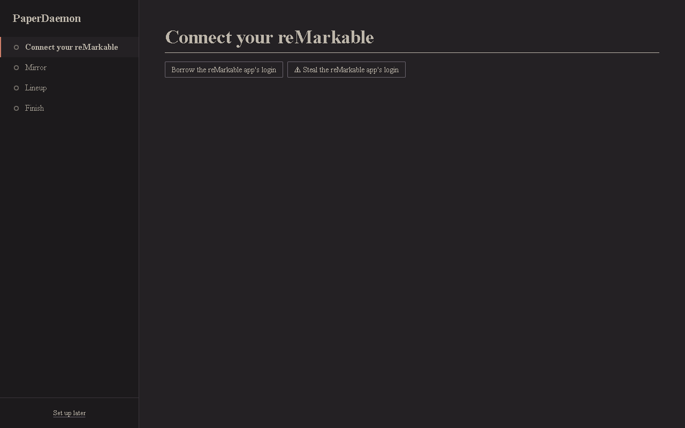
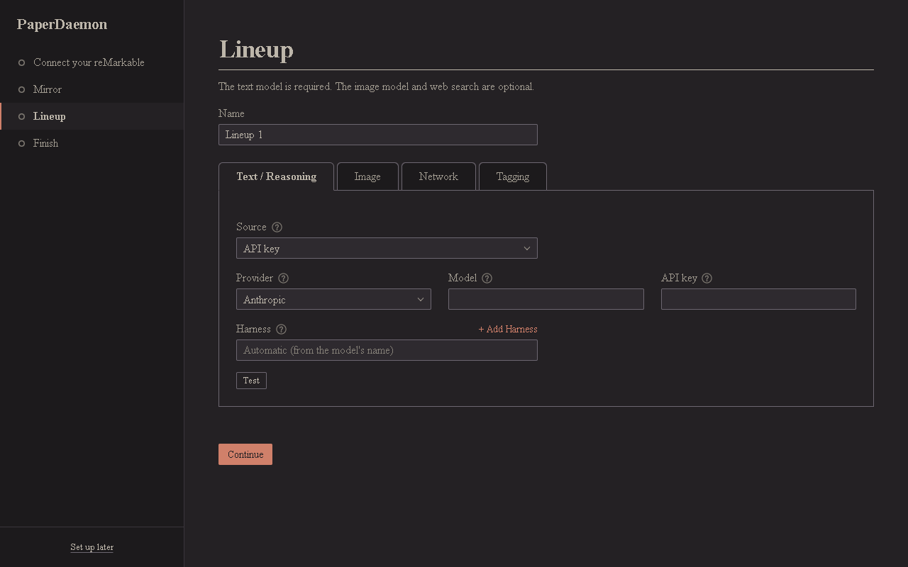
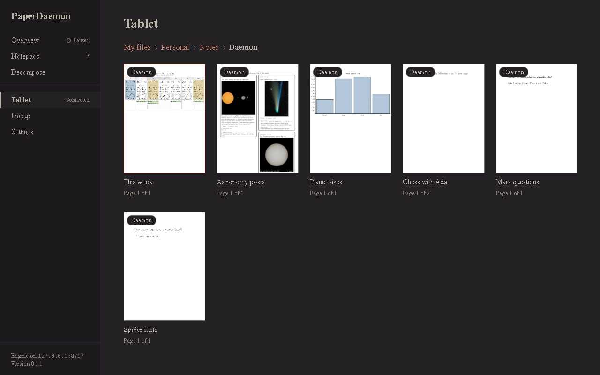
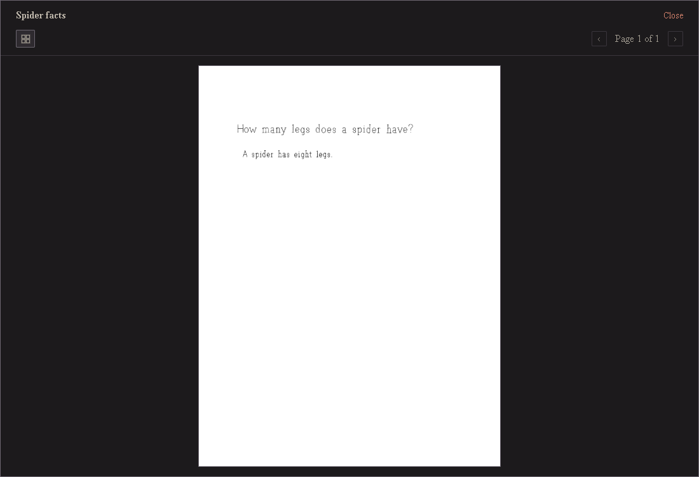
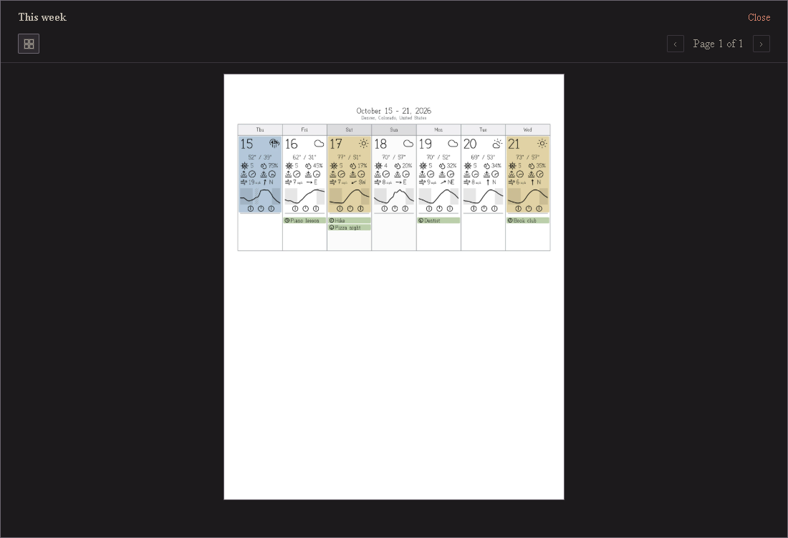
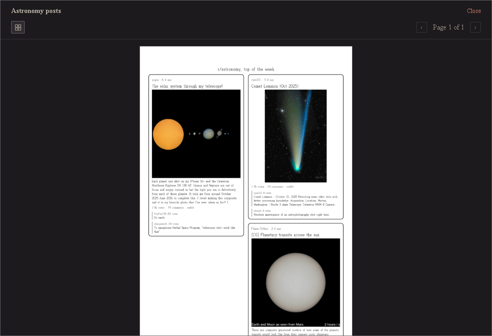
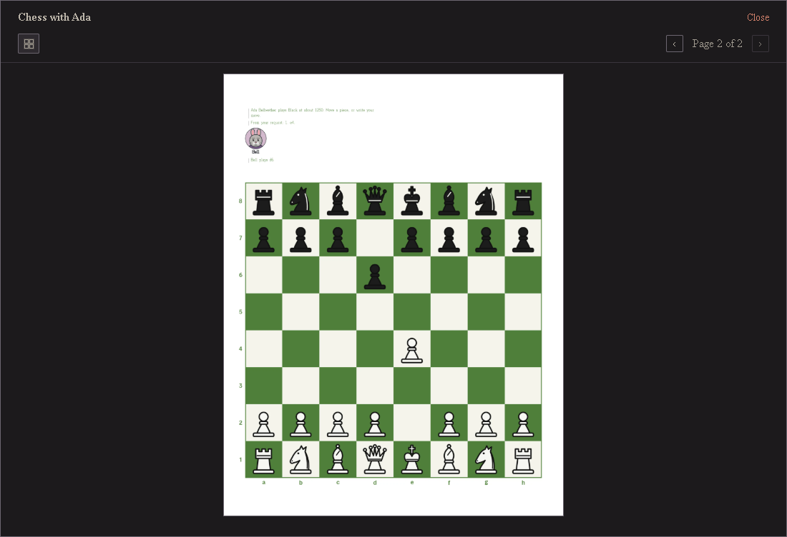
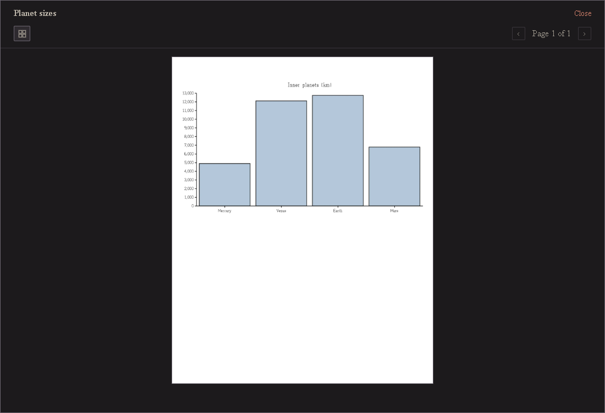
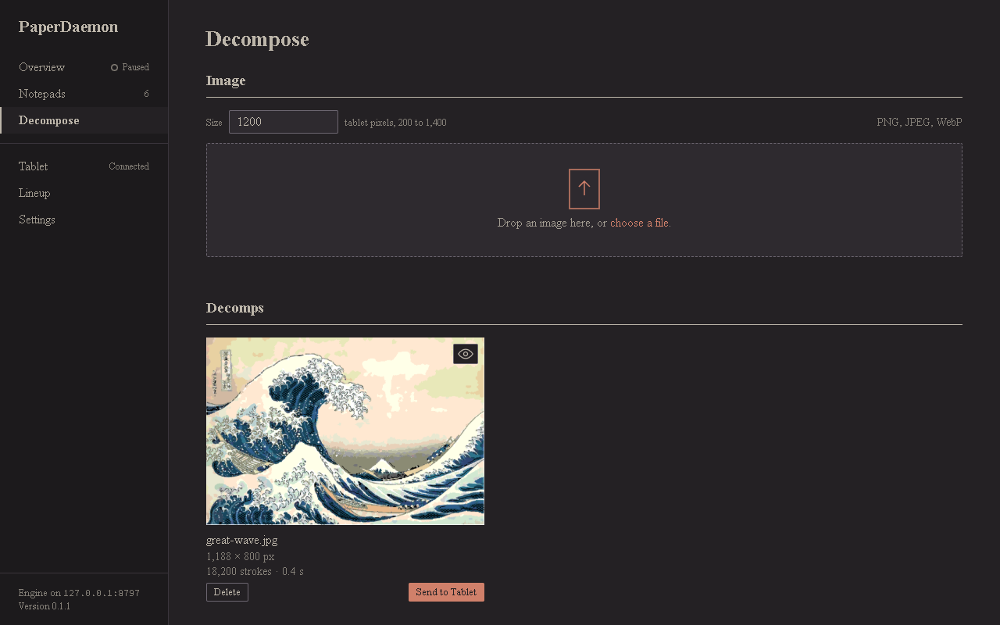

# PaperDaemon

A reMarkable assistant for Windows. Tag a page on your tablet and PaperDaemon answers it: a question gets an
answer written on the page, a request for a chart, a calendar, a picture or a coloring page gets one, and you
can play chess or a story game against characters drawn on the page. It runs on your own computer, with the
models you choose.

**[Download the installer](../../releases/latest)** (Windows,
`PaperDaemon_<version>_x64-setup.exe` under Assets)

1. **Set up.** The first start walks you through it: connect your reMarkable, let PaperDaemon copy your library,
   and choose the model it thinks with (an API key, or a model you run yourself), plus an image model if you
   like. Give the lineup a tag, such as `Daemon`.

   

   

2. **Tag a page on your tablet.** Write or type what you want on a page, then tag the page or the whole
   notebook with your tag. PaperDaemon sees it and does the work on the page.

   

   A handwritten question, answered:

   

   This week, with the forecast and your plans:

   

   The week's top posts from a subreddit:

   

   A game of chess against a character:

   

   A chart from real numbers:

   

3. **Send a picture to your tablet.** Drop an image on the Decompose screen. PaperDaemon redraws it in pen strokes,
   ready to send to a page of your notebook.

   

## License

PaperDaemon is licensed under the [Apache License 2.0](LICENSE). Copyright 2026 The PaperDaemon Authors; see
[NOTICE](NOTICE). It ships third-party components under their own licenses, listed in
[THIRD_PARTY_NOTICES.md](THIRD_PARTY_NOTICES.md); among them Stockfish, under the GNU GPL version 3, as a
separate program next to PaperDaemon.
